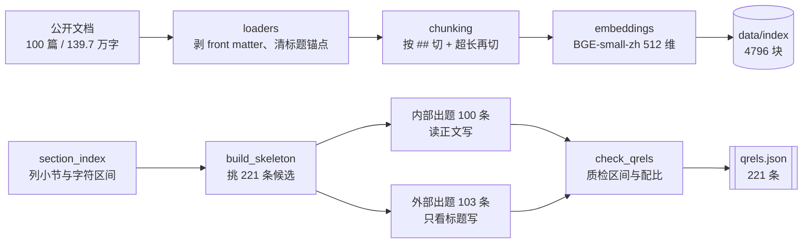
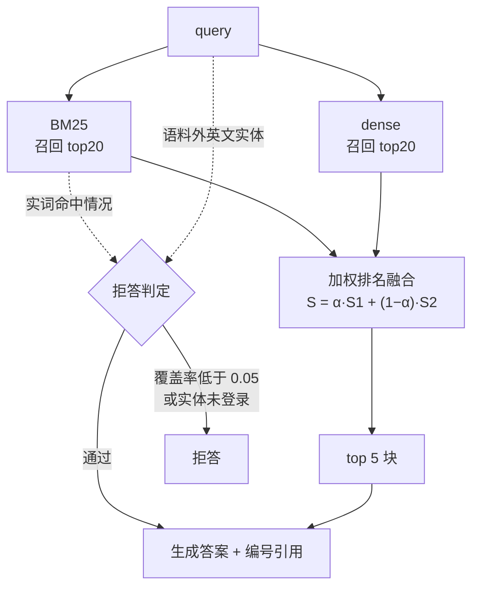

# RAGKit

[](https://github.com/shenjingzhonggudie/nexus-rag/actions/workflows/tests.yml)

从零手搓的中文 RAG（检索增强生成）系统，覆盖 **加载 → 分块 → 向量化 → 建库 → 混合检索 → 重排 → 生成 → 评测 → 消融** 全链路。核心算法（BM25、RRF 融合、重排、拒答、评测指标）全部自己实现。

**设计前提**：不使用 LangChain、LlamaIndex 等 RAG 框架；默认模式**离线可运行、不需要 API Key、不联网**。真实向量模型与 LLM 只作为可选适配器接入（当前为 hashing 字面级 embedding + 抽取式回答）。

## 当前状态

**全链路已贯通，四入口可用。** 287 条测试全绿。

- 四个 CLI 子命令：`build` / `ask` / `serve` / `eval`；
- HTTP API：`POST /ask`、`GET /healthz`（索引常驻内存，只付一次冷启动）；
- 评测语料：**公开中文技术文档**（Kubernetes / TiDB / Vue / React 共 100 篇、
  139.7 万字，由脚本按需拉取、正文不进仓库）+ **小节级标注**（221 条，五类配比）；
- 拒答：按「查询实词被检索结果覆盖的比例」判定，阈值可配，评测同时报告
  拒答准确率与误拒率；
- 检索链路：BM25 + dense 双路召回 → **加权排名融合** `S(d)=α·S1(d)+(1−α)·S2(d)`（α=0.9）；
- 消融结论（详见「评测与消融」）：**加权融合优于等权 RRF**（rerank +0.039）；
  dense 腿在 bge 下贡献 **+0.039**、hashing 下仅 +0.004。

## 关键结果：改进前后

同一套语料（100 篇 / 139.7 万字）与标注（221 条）上，从「脚本生成的合成语料 +
字面级向量」走到「真实公开文档 + 语义向量 + 加权融合」，每一步都有实测数字：

| 改动 | 改前 | 改后 | 实测变化 |
|---|---|---|---|
| **数据** | 脚本生成 10 篇（堆字数） | 公开文档 100 篇 / 139.7 万字 | 从"能跑"到"能说服人" |
| **标注** | 25 条，标 `chunk_id` | 221 条，标「文档 + 字符区间」 | 换 `chunk_size` **不用重标** |
| **dense 向量** | hashing 字面级（512 维哈希） | **BGE-small-zh**（512 维语义） | recall@1 **0.343 → 0.378**（+0.035）<br>MRR **0.443 → 0.485**（+0.042） |
| **精排** | dense 内积重排（**−0.039**，已废弃） | 加权排名融合 `S=α·S1+(1−α)·S2` | 同 bge 下 vs 等权 RRF **+0.039** |
| **拒答** | 只判"结果是否为空"→ **永不触发** | 外来实体 + 实词覆盖率阈值 | 准确率 **0% → 100%**，误拒率 **0.5%** |
| **标注视角** | 只有"读正文出题" | 增加 103 条"只看标题出题" | 暴露 **−27%** 的出题者偏差 |

**两个反直觉的发现**（都是实测出来的，不是猜的）：

1. **精排不该用向量**：原本以为"用 embedding 精排"更准，实测却是负贡献——它的打分函数
   与 dense 腿完全相同（同一次 `embed_text` + 点积），等于让一条腿一票否决另一条。
   改成加权排名融合后 **−0.039 → +0.039**。
2. **小样本会骗人**：外部组 27 条时 recall@1 = 0.333，扩到 103 条后掉到 0.282。
   之前那个"差距不大"的结论，纯粹是样本太小。

**当前指标**（bge + 加权融合）：

| 组 | n | recall@1 | recall@3 | recall@5 | MRR |
|---|---|---|---|---|---|
| `internal`（读正文出题，能力基准） | 100 | **0.390** | 0.515 | 0.570 | **0.502** |
| `external`（只看标题出题，用户视角） | 103 | **0.282** | 0.379 | 0.427 | **0.338** |
| 拒答（18 条无答案） | — | 准确率 **1.000** | — | — | 误拒率 **0.005** |

> 不报「合计」：合计随两组题量比例变化，反映的是评测集构成，不是系统能力。

| 项 | 值 |
|---|---|
| 版本 | 1.0.0 |
| Python | >= 3.11（开发环境使用 3.12） |
| 运行平台 | 主要面向 Windows + PowerShell，代码本身跨平台 |
| 运行时依赖 | `pyyaml` `pydantic` `jieba` `numpy` |

## 快速开始

```powershell
# 1. 进入项目目录
cd "C:\Users\王佳浩\Desktop\项目"

# 2. 创建虚拟环境（用 3.12；不要用 3.14，部分依赖可能缺少预编译包）
py -3.12 -m venv .venv

# 3. 可编辑安装（-e 表示不复制代码，只写路径映射；.[dev] 一并装 pytest）
.\.venv\Scripts\python.exe -m pip install --upgrade pip
.\.venv\Scripts\python.exe -m pip install -e ".[dev]"

# 4. 建库（索引 data/raw → data/index）
.\.venv\Scripts\ragkit.exe build

# 5. 问答（回答 + 编号引用来源）
.\.venv\Scripts\ragkit.exe ask "容器冷启动怎么优化？"

# 6. 评测（打印摘要 + 落盘 reports/eval.json）
.\.venv\Scripts\ragkit.exe eval
```

> 为什么不先激活虚拟环境？PowerShell 的默认执行策略可能禁止运行 `Activate.ps1`，直接调用 `.\.venv\Scripts\python.exe` 效果相同，且不必改动系统设置。

### 启动 HTTP API

```powershell
.\.venv\Scripts\ragkit.exe serve --port 8000
# 另开终端：
# curl -X POST http://127.0.0.1:8000/ask -d '{"query": "容器冷启动"}'
# curl http://127.0.0.1:8000/healthz
```

### 验收命令

```powershell
.\.venv\Scripts\python.exe -m pytest -q          # 预期：291 passed
.\.venv\Scripts\ragkit.exe --help                # 预期：列出 build/ask/serve/eval 四子命令
.\.venv\Scripts\ragkit.exe --version             # 预期：ragkit 1.0.0
```

## 四个命令详解

| 命令 | 作用 | 关键参数 |
|---|---|---|
| `ragkit build` | 建库：`data/raw` → `data/index`，打印统计 | `--config PATH`（YAML 配置）、`--root PATH`（覆盖语料目录） |
| `ragkit ask QUERY` | 问答：回答原文 + `[1] 来源` 引用；拒答提示"未找到相关内容" | `--config PATH` |
| `ragkit serve` | 启动 HTTP API（`POST /ask`、`GET /healthz`） | `--host`、`--port`、`--config` |
| `ragkit eval` | 跑评测集：打印 recall@1~10 / MRR / 耗时，落盘 `reports/eval.json` | `--config`、`--qrels`、`--out` |

**退出码约定**：`0` = 成功（**含拒答**——拒答是业务正常结果，不是错误）；`1` = 运行错误（配置非法 / 索引缺失损坏 / 语料目录不存在）；`2` = 用法错误（argparse 自带）。

**配置优先级**：命令行参数 > 环境变量（`RAG__*` 前缀）> YAML 配置 > 模型默认值。默认 `data_dir = data/raw`、`index_dir = data/index`。

## Docker

镜像**不含语料与索引**——两者都是可再生产物（在 `.gitignore` 里），所以运行时挂载：

```powershell
# 1. 宿主机先把索引建好（需要 data/raw + 一次 build）
ragkit build

# 2. 构建并启动（挂载 data/，否则容器里没有索引可查）
docker build -t ragkit .
docker run --rm -p 8000:8000 -v "${PWD}/data:/app/data" ragkit

# 3. 验证
curl http://localhost:8000/healthz
```

**为什么不在镜像里 build**：`data/raw` 是第三方文档，再分发受各自许可证约束；而且
100 篇编码要跑几分钟，不适合放进构建阶段。

**为什么默认不装 BGE**：`pip install .` 只装 `pyyaml/pydantic/jieba/numpy`，镜像约 400MB。
要用语义模型需改 Dockerfile 为 `pip install ".[embedding]"` 并把模型预下载进镜像（再 +1.5GB）。

> 该 Dockerfile **尚未在真实 Docker 环境验证**（开发机未安装 Docker）。

## 架构分层

### 离线：建库与标注



### 在线：一次查询



### 分层职责

```
loaders/      文本加载：.txt/.md/.markdown，UTF-8 + GBK 回退，坏文件隔离
chunking/     分块：heading（按 ## 标题，超长小节 fixed 再切）+ fixed，稳定 chunk_id（内容哈希）
embeddings/   hashing 字面级（默认，离线零依赖）/ bge 本地语义模型（可选依赖组）
stores/       NumPy 向量库：五文件落盘（manifest 最后写）+ 加载校验（manifest 记录 provider）
retrieval/    BM25（idf 词权重）→ dense（向量点积）→ 等权 RRF / 加权排名融合（rerank）
index/        建库编排 build / load_index（chunks.jsonl 落盘 + id 一致性校验）
generation/   answer_question：证据→引用、两类拒答（空结果 / 覆盖率低于阈值）、抽取式回答
api/          HTTP API：壳芯分离、错误翻译表、请求日志
evaluation/   覆盖式 recall@k / MRR + 拒答指标 + 小节级标注（区间重叠，不绑切分）
```

每层的契约（公开 API、边界规则、责任归属）详见配套文档 `docs/PROJECT_LAYOUT.md`。

## 评测与消融

**指标**：`recall@k`（1~10，覆盖式）、`MRR`、**拒答准确率 / 误拒率**、冷热耗时表。

**关于口径（重要，别只看绝对值）**：标注分两个来源，`ragkit eval` **只报分组、不报合计**：

| 来源 | 数量 | 怎么来的 | recall@1 | recall@3 | MRR |
|---|---|---|---|---|---|
| `internal` | 100 | 读过正文后出题，**答案保证能被该节回答** | **0.390** | 0.515 | **0.502** |
| `external` | 103 | 只给标题、不看正文出题，更接近真实用户问法 | **0.282** | 0.379 | **0.338** |

**为什么没有「合计」数字**：合计会被两组的题目比例左右（external 占比一高，整体就掉），
它反映的是**评测集构成**，不是**系统能力**。所以任何对外汇报都必须两组并列，不报单一数字。

两组的定位不同，缺一不可：

- `internal` 是**能力基准**——换 embedding / 调融合参数时用它对比，不受提问方式干扰；
- `external` 是**真实用户视角**——它比 internal 低 **27%**（recall@1）、**33%**（MRR），
  说明检索器相当依赖文档措辞；
- **小样本偏乐观**：外部组 27 条时 recall@1 是 0.333，扩到 103 条后降到 0.282。
  这是扩样的直接价值——27 条那种量级得出的"差距不大"是不可靠的。

**两个已知限制**：

1. 外部组只含 `direct` / `paraphrase`，因为「只看标题」写不出 `multi_block`（答案分散在
   2~3 节）和 `cross_doc`（跨文档对比）——这两类必须知道内容才能出。它们仍全部来自
   内部组（16 + 6 条），测的是"能力"而非"用户视角"。
2. 外部组抓出过两个判据 bug（`AUTO_RANDOM` 被误判为语料外技术、阈值过严），
   内部组永远看不到——这是独立样本的额外价值。

**标注口径：不绑切分。** 答案标的是「文档 + 小节字符区间」，评测时判断召回的
块与该区间**是否重叠**（同文档且区间相交）。换 `chunk_size`、换分块策略都不
需要重标，也不会因为块边界挪动而误判——这是本轮最重要的设计决定。

**拒答口径（两层判据）**：

1. **外来实体（强信号）**：查询里首字母大写的英文专有名词（Kafka / JVM /
   ZooKeeper）如果语料中从未出现，直接判拒答——真实文档里这类"问完全没收录的
   技术"是最常见的无答案场景；
2. **实词覆盖率（兜底）**：查询实词的 idf 加权覆盖率低于阈值则拒答，用于覆盖
   "同领域但确实没答案"的情况。

阈值 `refuse_threshold` 默认 **0.05**。在真实语料（100 篇 / 145 条标注）上实测：
**拒答准确率 100%、误拒率 0.8%**。两个细节容易踩坑：① `v-model` / `v-if` 这类
小写框架指令不能当"外来实体"（分词形式不稳定，会误拒正常问题）；② 融合分不能
做阈值——RRF 分数只是排名分（0.012~0.017），不反映匹配质量。

**消融**（145 条标注、bge embedding，单变量对照）：

| 组 | @1 | @2 | @3 | @4 | @5 | @6 | @7 | @8 | @9 | @10 | MRR |
|---|---|---|---|---|---|---|---|---|---|---|---|
| **baseline（加权排名融合 α=0.9）** | **0.38** | 0.46 | 0.51 | 0.52 | 0.57 | 0.57 | 0.57 | 0.57 | 0.57 | 0.57 | **0.485** |
| no_rerank（等权 RRF） | 0.34 | 0.46 | **0.53** | **0.58** | **0.59** | 0.59 | 0.59 | 0.59 | 0.59 | 0.59 | 0.477 |
| bm25_only（纯 BM25） | 0.34 | 0.41 | 0.48 | 0.51 | 0.53 | 0.53 | 0.53 | 0.53 | 0.53 | 0.53 | 0.446 |
| dense_only（纯 dense） | 0.29 | 0.40 | 0.46 | 0.52 | 0.54 | 0.54 | 0.54 | 0.54 | 0.54 | 0.54 | 0.421 |

**边际贡献（按 recall@1）**：BM25 腿 **+0.091**、dense 腿 **+0.039**、
rerank（加权 vs 等权）**+0.039**。

**结论**：

1. **rerank 现在是正资产**（+0.039）——但前提是它做的是**加权排名融合**
   `S(d) = α·S1(d) + (1−α)·S2(d)`，而不是早期的「用 dense 向量内积重排」
   （那等于让 dense 分数一票否决 BM25，实测 **−0.039**）。
2. **dense 腿的贡献随 embedding 变化**：hashing 下 +0.004（几乎为零）、bge 下 **+0.039**；
   `dense_only` 的 MRR 也从 0.319 升到 0.421。
3. **两种融合各有所长**：加权（α=0.9）**@1 更高**（0.38 vs 0.34），等权 RRF **@5 更高**
   （0.59 vs 0.57）——等权给 dense 更多话语权，能捞回 BM25 漏掉的块；按 MRR 看加权略优
   （0.485 vs 0.477）。

**方法论约束**：每次只改一个开关；单腿组必须同时关 rerank。**对照组必须与默认值相反**
才有信息量——`rerank_enabled` 默认已是 `True`（加权融合），所以对照是 `no_rerank`
（等权 RRF）；反过来若某开关默认是关的，对照才该是"打开它"。

## 目录结构

```text
项目/
├── pyproject.toml          # 构建配置、CLI 入口点、pytest 配置
├── README.md               # 本文件
├── .gitignore
├── AGENTS.md               # 交接指南（给下一个接手的人/agent）
├── configs/default.yaml    # 默认配置模板（值须与模型默认值一致）
├── data/                   # 语料与评测数据（详细说明见 data/README.md）
│   ├── raw/                # 公开技术文档正文（脚本拉取，gitignore，不进仓库）
│   ├── eval/qrels.json     # 小节级标注：文档 + 小节字符区间（不绑切分）
│   ├── eval/qrels.example.json  # 五类标注的格式示例
│   └── SOURCES.md          # 数据来源与许可证
├── docs/                   # 契约 / 学习记录 / 总结报告
├── reports/                # 评测报告落盘（eval.json / ablation.json）
├── scripts/                # 数据工具：fetch_docs / section_index / gen_queries / check_qrels
├── src/ragkit/             # 唯一被 import 的代码（分层见上）
└── tests/                  # 契约测试（291 条）
```

**数据来源与许可证**：语料取自 Kubernetes / Docker / Python / Vue / React 的公开
文档仓库，各自许可证见 `data/SOURCES.md`。仓库只提交**下载脚本与来源清单**，
不提交第三方正文——既避免体积膨胀，也规避再分发许可风险。

## 开发说明

- **代码放在 `src/ragkit/`**，测试在 `tests/`；改动 `pyproject.toml` 后须重新 `pip install -e ".[dev]"`。
- **测试即契约**：每层的公开 API、边界行为都由 `tests/` 锁定；改默认值、改契约都要同步测试。
- **`.env` 防范意识**：将来接 LLM 时 API Key 放 `.env`，绝不能提交进 Git。
- **可再生的重建优于修补**：`data/index/` 是 `ragkit build` 的产物、`data/raw/` 是可按来源重新拉取的语料，两者都可再生；真正值得进版本控制的是 `data/eval/`（人工筛选过的标注）与 `data/SOURCES.md`（来源与许可证）。
- **标注不要绑切分**：答案标「文档 + 小节字符区间」，不要标 `chunk_id`——切分策略一改，`chunk_id` 全部失效，标注就白做了。
- **评测要有盲测集**：调参只看 80% 的题，剩下 20% 留到最后报告，防止把噪声调成"最优参数"（样本只有几十条时尤其重要）。

## 常见问题

| 现象 | 原因与处理 |
|---|---|
| `ModuleNotFoundError: No module named 'ragkit'` | 未执行可编辑安装，重新 `pip install -e ".[dev]"` |
| 命令行找不到 `ragkit` | 安装时没带 `-e`，或 `[project.scripts]` 未声明 |
| `ragkit ask` 提示"先运行 ragkit build" | 索引缺失或损坏，先执行 `ragkit build` |
| `ragkit eval` 全 0 | `data_dir` 与评测集 doc_id 口径不一致，确认 `data_dir = data/raw` |
| `Activate.ps1 无法加载` | 不必改执行策略，直接 `.\.venv\Scripts\python.exe` 调用 |
| 中文输出乱码 | 读写显式 `encoding="utf-8"`；可设 `PYTHONUTF8=1` |
| 安装 3.14 后依赖装不上 | 开发环境固定用 Python 3.12 |

## 路线图

| 状态 | 内容 |
|---|---|
| ✅ 已完成 | 骨架 → 领域模型/配置 → 加载/分块 → 向量化/向量库 → BM25/混合检索/融合/重排 → 建库 → 生成 → CLI → HTTP API → 评测 → 消融 |
| ⬜ 扩展（触发信号驱动） | 真语义 embedding（dense 腿重估）、cross-encoder rerank、`openai_compatible` 真实生成、增量更新、HTML/PDF 加载器、FastAPI 迁移、鉴权 |

## 说明

本项目是学习项目，目标是"能独立解释并重写每个核心模块"，而不是"尽快得到一个能跑的仓库"。每个阶段先写测试、再写实现；评测与消融结论如实记录，不隐瞒失败样本与已知局限。开发全程的决策、踩坑、通用规律见 `docs/LEARNING_LOG.md`，系统契约见 `docs/PROJECT_LAYOUT.md`。
